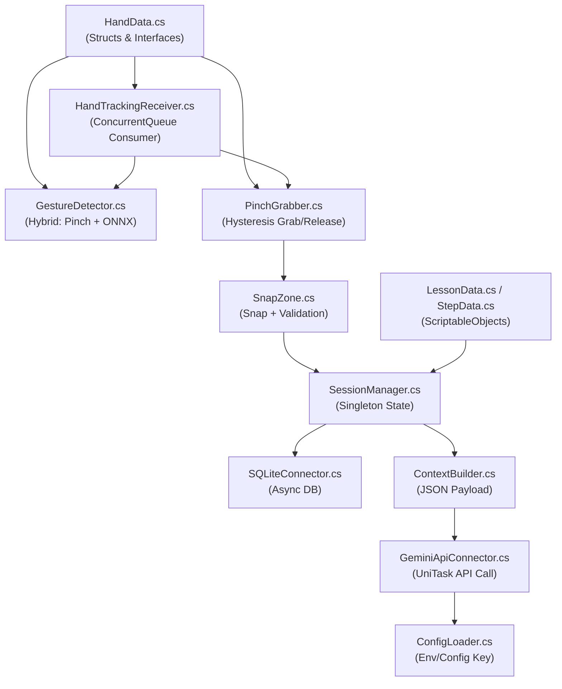

<![CDATA[# Monitor AR Technical Training Simulator — Implementation Plan

Hiện thực hóa toàn bộ mã nguồn C# cho hệ thống "Monitor AR Technical Training Simulator" theo đặc tả Master Plan V3.1. Toàn bộ cấu trúc thư mục và 12 file C# đã được sinh ra, sẵn sàng biên dịch trong Unity 2022.3 LTS.

---

## User Review Required

> [!IMPORTANT]
> **Vấn đề Plugin MediaPipe Unity:** Master Plan yêu cầu dùng "MediaPipe C# Plugin" nhưng không chỉ rõ package cụ thể nào (có nhiều bản: `MediaPipeUnityPlugin` của homuler, `MediaPipe4U`, v.v.). Code đã thiết kế một **interface trừu tượng** (`IHandTrackingProvider`) để có thể plug bất kỳ MediaPipe plugin nào vào sau. Một `MockHandTrackingProvider` cũng đã được cung cấp để test mà không cần camera.

> [!IMPORTANT]
> **File mô hình ONNX (`gesture_model.onnx`):** Hệ thống Sentis cần file `.onnx` thực. Code đã sinh đầy đủ logic load/inference nhưng cần cung cấp file mô hình riêng. Code xử lý gracefully nếu file chưa tồn tại (log warning, skip inference).

> [!WARNING]
> **Thư viện bên ngoài cần cài thủ công trong Unity Editor:** `UniTask`, `Newtonsoft.Json`, `sqlite-net-pcl`, `com.unity.sentis`, `com.unity.render-pipelines.universal`, MediaPipe plugin. Code sử dụng `#if` conditional compilation để không crash nếu thiếu package, nhưng cần cài chúng trước khi build.

## Open Questions

> [!IMPORTANT]
> 1. **Chọn MediaPipe Plugin cụ thể:** Đang dùng [homuler/MediaPipeUnityPlugin](https://github.com/homuler/MediaPipeUnityPlugin) hay plugin khác? Điều này ảnh hưởng cách implement `IHandTrackingProvider`. Nếu chưa chọn, code sẽ dùng interface trừu tượng + Mock provider.
> 2. **Danh sách 14 cử chỉ động:** Master Plan đề cập 14 gesture classes (Swipe, Tap, Fist...) nhưng chưa liệt kê đầy đủ. Hiện tại code định nghĩa enum mặc định gồm: `None, SwipeLeft, SwipeRight, SwipeUp, SwipeDown, Tap, DoubleTap, Fist, OpenPalm, ThumbsUp, ThumbsDown, Peace, PointUp, Grab`.
> 3. **Gemini API Endpoint & Model:** Master Plan ghi "Gemini 3.5 Flash". Code hiện sử dụng endpoint `generativelanguage.googleapis.com` với model `gemini-2.0-flash`.

---

## Proposed Changes

Tổng cộng **12 file C#** + **1 file cấu hình** đã được sinh ra theo cấu trúc thư mục bắt buộc:

```
d:\WORKSAPCE\3_AI_Agent_Workspace\Assets\
  Scripts\
    Core\
      SessionManager.cs          ← Singleton quản lý trạng thái bài học trên RAM
    Interaction\
      HandData.cs                ← Struct dữ liệu tay (21 landmarks) + enum + interfaces
      HandTrackingReceiver.cs    ← Producer-Consumer queue, Fail-Safe timeout
      PinchGrabber.cs            ← Gắp/thả linh kiện bằng Pinch + Hysteresis
      SnapZone.cs                ← Hệ thống bắt dính (Snap) linh kiện
      GestureDetector.cs         ← Hybrid: Pinch tức thì + ONNX Sliding Window
    AI\
      ConfigLoader.cs            ← Đọc API Key từ env var / config.json
      ContextBuilder.cs          ← Sinh JSON payload chứa trạng thái 3D
      GeminiApiConnector.cs      ← Gọi Gemini API bất đồng bộ (UniTask)
    Data\
      LessonData.cs              ← ScriptableObject giáo án
      StepData.cs                ← Serializable step data
    Database\
      SQLiteConnector.cs         ← CRUD SQLite cục bộ (UniTask)
  StreamingAssets\
    config.json                  ← File cấu hình API key (ngoài Assets build)
```

---

### Module 1: Data Layer (ScriptableObjects)

Tầng dữ liệu tĩnh — không phụ thuộc vào bất kỳ module nào khác.

#### [DONE] [StepData.cs](file:///d:/WORKSAPCE/3_AI_Agent_Workspace/Assets/Scripts/Data/StepData.cs)
- Class `[System.Serializable]` chứa: `stepIndex`, `requiredPartID`, `snapZoneID`, `instructionText`, `hintText`.
- Thuần data, không MonoBehaviour.

#### [DONE] [LessonData.cs](file:///d:/WORKSAPCE/3_AI_Agent_Workspace/Assets/Scripts/Data/LessonData.cs)
- `ScriptableObject` với `[CreateAssetMenu]`.
- Fields: `lessonID`, `lessonTitle`, `description`, `List<StepData> assemblySteps`.
- Validation method `OnValidate()` tự động sắp xếp steps theo `stepIndex`.

---

### Module 2: Core (Session Management)

Singleton quản lý state trên RAM — phụ thuộc Data layer.

#### [DONE] [SessionManager.cs](file:///d:/WORKSAPCE/3_AI_Agent_Workspace/Assets/Scripts/Core/SessionManager.cs)
- **Pattern:** Lazy Singleton (thread-safe) kế thừa MonoBehaviour, `DontDestroyOnLoad`.
- **State fields:** `currentLessonData`, `currentStepIndex`, `mistakeCount`, `sessionStartTime`, `currentUserId`.
- **Public API:**
  - `StartLesson(LessonData lesson)` — reset counters, bắt đầu timer.
  - `GetCurrentStep() → StepData` — trả về step hiện tại.
  - `AdvanceStep()` — tăng index, fire event `OnStepChanged`.
  - `RecordMistake()` — tăng `mistakeCount`, fire event `OnMistakeRecorded`.
  - `CompleteLesson()` — tính score, gọi `SQLiteConnector.InsertSessionAsync()`, fire event `OnLessonCompleted`.
- **Events:** `Action<LessonData> OnLessonStarted`, `Action<StepData> OnStepChanged`, `Action OnMistakeRecorded`, `Action<float> OnLessonCompleted`.
- Tính điểm: `score = max(0, 100 - mistakeCount * 10)`.

---

### Module 3: Interaction (Hand Tracking + Gestures + Physics)

Đây là tầng phức tạp nhất, chứa toàn bộ logic Producer-Consumer.

#### [DONE] [HandData.cs](file:///d:/WORKSAPCE/3_AI_Agent_Workspace/Assets/Scripts/Interaction/HandData.cs)
- `readonly struct HandData` chứa:
  - `Vector3[] Landmarks` (21 phần tử — deep copy trong constructor).
  - `float Timestamp`.
  - `bool IsTracking`.
- Enum `GestureType`: `None, SwipeLeft, SwipeRight, SwipeUp, SwipeDown, Tap, DoubleTap, Fist, OpenPalm, ThumbsUp, ThumbsDown, Peace, PointUp, Grab` (14 loại).
- Enum `PinchState`: `Released, Grabbed`.
- Interface `IHandTrackingProvider` với method `void StartTracking()`, `void StopTracking()`, property `bool IsAvailable`, event `Action<HandData> OnHandDataReceived`.
- Interface `IGrabbable` với property `string PartID`, method `bool CanGrab()`, `void OnGrab()`, `void OnRelease()`.
- Class `MockHandTrackingProvider : MonoBehaviour, IHandTrackingProvider` — giả lập bằng chuột để test.

#### [DONE] [HandTrackingReceiver.cs](file:///d:/WORKSAPCE/3_AI_Agent_Workspace/Assets/Scripts/Interaction/HandTrackingReceiver.cs)
- **Vai trò:** Consumer — đọc từ `ConcurrentQueue<HandData>`, phân phối cho các hệ thống con.
- **Cấu trúc:**
  - `ConcurrentQueue<HandData> _handDataQueue` (static, thread-safe).
  - `static void EnqueueHandData(HandData data)` — Producer gọi từ background thread.
  - Trong `Update()`:
    1. `TryDequeue` tất cả dữ liệu mới (drain queue).
    2. Lấy frame mới nhất, Lerp vị trí cursor 3D (`_smoothedPosition = Vector3.Lerp(...)`, `lerpSpeed = 15f`).
    3. Cập nhật `_lastReceivedTime`.
    4. Fire event `OnHandUpdate(HandData)`.
  - **Fail-Safe:** Nếu `Time.time - _lastReceivedTime > 0.3f` → fire `OnTrackingLost()`, gọi `ForceReleaseObject()`.
- **Raycasting:** Ánh xạ Landmark 8 (ngón trỏ) qua `Camera.main.ScreenPointToRay()`, cắt Virtual Touch Plane → `_cursor3DPosition`.
- **Serialized Fields:** `Transform cursorVisual`, `float virtualPlaneZ = 5f`, `float lerpSpeed = 15f`, `float trackingTimeoutSeconds = 0.3f`, `Camera mainCamera`.
- **Events:** `Action<HandData> OnHandUpdate`, `Action OnTrackingLost`.

#### [DONE] [PinchGrabber.cs](file:///d:/WORKSAPCE/3_AI_Agent_Workspace/Assets/Scripts/Interaction/PinchGrabber.cs)
- **Vai trò:** Gắp/thả linh kiện bằng cử chỉ Pinch với Hysteresis.
- **Nghe sự kiện:** Subscribe `HandTrackingReceiver.OnHandUpdate` và `OnTrackingLost`.
- **Thuật toán Hysteresis:**
  - Tính `d = Vector3.Distance(landmark[4], landmark[8])` (ngón cái tip → ngón trỏ tip).
  - `_pinchStartThreshold = 0.04f`, `_pinchEndThreshold = 0.06f`.
  - State machine: `Released` ↔ `Grabbed`.
- **Khi Grabbed:**
  - `Physics.OverlapSphere()` tìm `IGrabbable` component trên object gần nhất.
  - Parent object theo cursor, scale down 5% (cảm giác nắm).
  - Fire `OnObjectGrabbed(GameObject)`.
- **Khi Released:**
  - Detach object, reset scale.
  - Kiểm tra gần SnapZone nào → gọi `SnapZone.TrySnap()`.
  - Fire `OnObjectReleased(GameObject, Vector3)`.

#### [DONE] [SnapZone.cs](file:///d:/WORKSAPCE/3_AI_Agent_Workspace/Assets/Scripts/Interaction/SnapZone.cs)
- **Serialized Fields:** `snapZoneID`, `expectedPartID`, `snapRadius = 0.3f`, `Transform snapPoint`, `AudioClip snapSuccessSound/snapErrorSound`, `Material errorMaterial`, `float errorFlashDuration = 1.0f`.
- **Public method:** `bool TrySnap(GameObject part)` — kiểm tra khoảng cách ≤ `snapRadius` VÀ `part.PartID == expectedPartID`.
- **Khi snap thành công:**
  - Đặt `part.transform.position/rotation = snapPoint`.
  - Set `Rigidbody.isKinematic = true`.
  - Phát âm thanh thành công.
  - Đánh dấu `IsOccupied = true`.
- **Khi snap sai part:**
  - Phát âm thanh cảnh báo.
  - Flash material đỏ (async UniTask, 1 giây).
  - Gọi `SessionManager.Instance.RecordMistake()`.
- **Self-Registering Registry:** Static `List<SnapZone> _allZones` — tự đăng ký `OnEnable()`, hủy `OnDisable()`.
- **Static method:** `FindNearestSnapZone(Vector3 position, float maxRange)` — tìm zone gần nhất chưa occupied.

#### [DONE] [GestureDetector.cs](file:///d:/WORKSAPCE/3_AI_Agent_Workspace/Assets/Scripts/Interaction/GestureDetector.cs)
- **Hybrid Architecture — 2 nhiệm vụ song song:**

**Task 1: Pinch Detection (Instant, 0ms)**
- Trích xuất khoảng cách Euclidean thumb-tip ↔ index-tip.
- Trả về trạng thái `PinchState` với Hysteresis.

**Task 2: Dynamic Gesture via ONNX (Sliding Window)**
- Duy trì `List<float[]> _slidingWindow` (max 15 frames, FIFO).
- Mỗi frame: flatten 21 landmarks × 3 = 63 floats, push vào buffer.
- Khi đủ 15 frames:
  - Tạo `TensorFloat` shape `[1, 15, 63]` từ buffer.
  - Gọi `_sentisWorker.Schedule(inputTensor)`.
  - Đọc output tensor, lấy class có confidence > 0.8f.
  - Nếu nhận diện thành công → fire event `OnDynamicGestureDetected(GestureType, float)`.
  - Khóa Cooldown 1 giây (`_cooldownTimer`).
- **Serialized Fields:** `ModelAsset gestureModel`, `float confidenceThreshold = 0.8f`, `float cooldownDuration = 1.0f`.
- **Graceful degradation:** Nếu `gestureModel == null` → log warning, skip ONNX inference, chỉ chạy Pinch. GPU lỗi → fallback CPU.
- **Events:** `Action<PinchState, float> OnPinchUpdate`, `Action<GestureType, float> OnDynamicGestureDetected`.

---

### Module 4: AI (Gemini Integration)

Tầng đám mây — async hoàn toàn qua UniTask.

#### [DONE] [ConfigLoader.cs](file:///d:/WORKSAPCE/3_AI_Agent_Workspace/Assets/Scripts/AI/ConfigLoader.cs)
- **Ưu tiên đọc API key:**
  1. Biến môi trường `GEMINI_API_KEY`.
  2. File `StreamingAssets/config.json` → parse field `"geminiApiKey"`.
  3. Giá trị mặc định cho model (`gemini-2.0-flash`) và timeout (`30` giây).
- **Static properties:** `GeminiApiKey`, `GeminiModel`, `GeminiTimeoutSeconds`.
- **Static method:** `void LoadConfig()` — idempotent (chỉ load 1 lần).

#### [DONE] [ContextBuilder.cs](file:///d:/WORKSAPCE/3_AI_Agent_Workspace/Assets/Scripts/AI/ContextBuilder.cs)
- **Public static method:** `string BuildContextJson(string lessonId, int currentStep, int totalSteps, string currentInstruction, string heldPartId, int mistakeCount, List<SnapZoneStatus> snapZones)`.
- **Struct `SnapZoneStatus`:** `string id`, `bool occupied`, `string partId`.
- Output JSON bao gồm:
  ```json
  {
    "lessonId": "engine_v1",
    "currentStep": 3,
    "totalSteps": 8,
    "currentInstruction": "Lắp piston vào xi-lanh",
    "heldPartId": "piston_01",
    "mistakeCount": 2,
    "snapZonesStatus": [{"id": "sz_cylinder", "occupied": false, "partId": ""}]
  }
  ```
- Sử dụng `Newtonsoft.Json.JObject` để serialize.

#### [DONE] [GeminiApiConnector.cs](file:///d:/WORKSAPCE/3_AI_Agent_Workspace/Assets/Scripts/AI/GeminiApiConnector.cs)
- **Singleton MonoBehaviour** với `DontDestroyOnLoad`.
- **Async method:** `UniTask<string> AskGeminiAsync(string userQuestion, string contextJson, CancellationToken ct)`.
- **Implementation:**
  1. Lấy key từ `ConfigLoader.GeminiApiKey`.
  2. Build system prompt: *"Bạn là trợ giảng kỹ thuật AR. Dựa vào context JSON sau để trả lời..."*.
  3. POST lên `https://generativelanguage.googleapis.com/v1beta/models/{model}:generateContent?key={apiKey}`.
  4. Dùng `UnityWebRequest` + `UniTask` với timeout liên kết qua `CancellationTokenSource`.
  5. Parse response JSON, trích `candidates[0].content.parts[0].text`.
- **Error handling (không throw exception):**
  - API key rỗng → return thông báo lỗi tiếng Việt.
  - Timeout → return `"⚠ Kết nối AI thất bại. Vui lòng thử lại."`.
  - Network error → log + return error message.
  - Content blocked → return `"⚠ Nội dung bị chặn..."`.

---

### Module 5: Database (SQLite)

#### [DONE] [SQLiteConnector.cs](file:///d:/WORKSAPCE/3_AI_Agent_Workspace/Assets/Scripts/Database/SQLiteConnector.cs)
- **ORM Classes:** `UserRecord` (maps to `Users` table), `TrainingSessionRecord` (maps to `TrainingSessions` table) với `[Table]`, `[PrimaryKey]` attributes.
- **Singleton pattern** — Pure C# (không phải MonoBehaviour), sử dụng `Lazy<T>` thread-safe.
- **Init:** `UniTask InitializeAsync()` — tạo DB file tại `Application.persistentDataPath/database.db`, `CreateTableAsync<T>()`.
- **CRUD:**
  - `UniTask<UserRecord> GetOrCreateUserAsync(string username, string fullName, CancellationToken ct)`.
  - `UniTask InsertSessionAsync(string userId, string lessonId, float totalTime, int mistakes, float score, CancellationToken ct)`.
  - `UniTask<List<TrainingSessionRecord>> GetSessionHistoryAsync(string userId, CancellationToken ct)`.
- Mọi method dùng `UniTask` + `CancellationToken`.
- Connection quản lý bằng `SQLiteAsyncConnection` (từ `sqlite-net-pcl`).

---

### Configuration File

#### [DONE] [config.json](file:///d:/WORKSAPCE/3_AI_Agent_Workspace/Assets/StreamingAssets/config.json)
```json
{
  "geminiApiKey": "YOUR_API_KEY_HERE",
  "geminiModel": "gemini-2.0-flash",
  "geminiTimeoutSeconds": 5
}
```

---

## Verification Plan

### Automated Tests
- **Biên dịch:** Tất cả 12 file C# phải biên dịch thành công khi mở trong Unity 2022.3 LTS với các package đã cài.
- **Null-safety:** Mọi path code đều xử lý null/missing references mà không crash (NullReferenceException).
- **Thread-safety:** `HandTrackingReceiver` sử dụng `ConcurrentQueue` — không có data race.

### Manual Verification
1. Import toàn bộ scripts vào Unity project đã cài đủ package.
2. Tạo ScriptableObject `LessonData` mẫu qua menu `AR_Training/LessonData`.
3. Gán `MockHandTrackingProvider` và test Pinch/Release cycle bằng chuột.
4. Kiểm tra SQLite database sinh ra ở `Application.persistentDataPath`.
5. Test Gemini API với API key thật qua `config.json`.

---

## Dependency Graph


]]>
