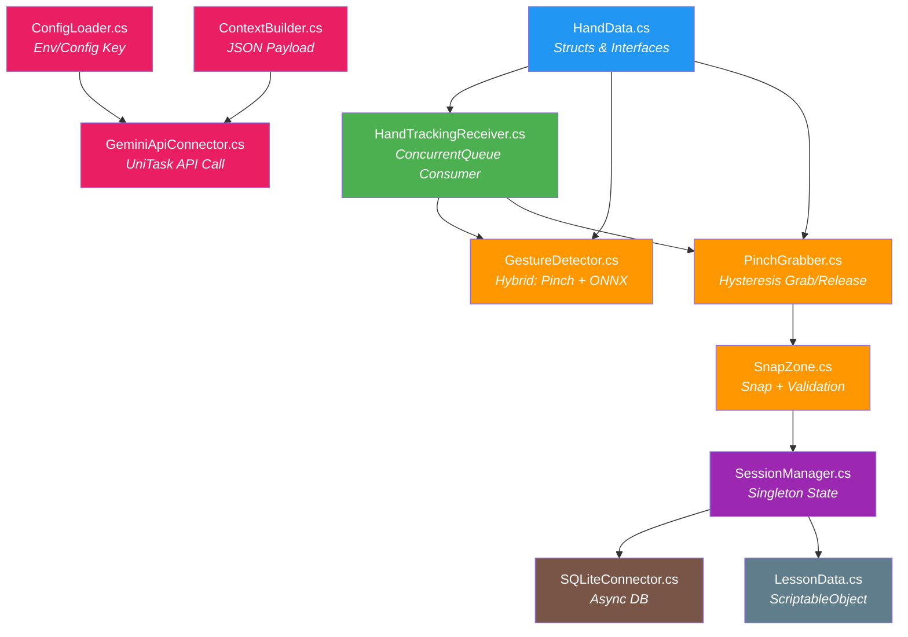

<](https://unity.com/)
[](https://docs.microsoft.com/en-us/dotnet/csharp/)
[](https://mediapipe.dev/)
[](https://ai.google.dev/)
[]()

</div>

---

## 📋 Mục lục

- [Giới thiệu](#-giới-thiệu)
- [Tính năng chính](#-tính-năng-chính)
- [Kiến trúc hệ thống](#-kiến-trúc-hệ-thống)
- [Cấu trúc thư mục](#-cấu-trúc-thư-mục)
- [Yêu cầu hệ thống](#-yêu-cầu-hệ-thống)
- [Cài đặt & Thiết lập](#-cài-đặt--thiết-lập)
- [Hướng dẫn sử dụng](#-hướng-dẫn-sử-dụng)
- [Tech Stack](#-tech-stack)
- [Tài liệu kỹ thuật](#-tài-liệu-kỹ-thuật)

---

## 🌟 Giới thiệu

**Motion AR** biến màn hình máy tính thành một **"tấm gương ma thuật"** — nơi người học có thể tương tác, bóc tách, và lắp ráp các mô hình kỹ thuật 3D (động cơ, bo mạch...) lơ lửng trước mặt bằng **cử chỉ tay thật** qua Webcam thông thường.

Hệ thống giải quyết bài toán **"bình dân hóa" công nghệ đào tạo AR** — không cần kính VR/AR đắt tiền, chỉ cần laptop/PC tầm trung và 01 Webcam là đủ để trải nghiệm thao tác điều khiển viễn tưởng như Iron Man.

### Triết lý thiết kế

| Nguyên tắc | Mô tả |
|---|---|
| 🖥️ **Hardware Agnostic** | Chỉ cần Webcam 720p — mọi tương tác không gian giải quyết qua thuật toán Computer Vision |
| ⚡ **Real-time & Thread-Safe** | Kiến trúc Producer-Consumer đảm bảo ≥30 FPS, triệt tiêu lỗi đa luồng Unity |
| 📦 **Modular & Offline-First** | Điều khiển vật lý xử lý cục bộ (0ms), chỉ gọi API đám mây khi cần trợ giảng AI |
| 🛡️ **Fail-Safe UX** | Bộ lọc Smoothing, Hysteresis chống nhiễu, tự giải phóng linh kiện khi mất tracking |

---

## ✨ Tính năng chính

### 🤚 Tương tác không gian bằng cử chỉ tay
- **Bóp/Chụm (Pinch)** — Gắp linh kiện 3D bằng ngón cái + ngón trỏ
- **Xòe tay (Release)** — Thả linh kiện, tự bắt dính vào vị trí đúng
- **Vuốt (Swipe)** — Điều hướng menu và giáo án
- **Chạm (Tap) / Nắm đấm (Fist)** — Kích hoạt micro hỏi trợ lý AI
- **14 cử chỉ động** — Nhận diện bằng Deep Learning (ONNX) qua cửa sổ trượt 15 frames

### 🧩 Hệ thống lắp ráp thông minh
- **Snap System** — Linh kiện tự hút chặt khi đưa vào bán kính dung sai
- **Cảnh báo lỗi** — Đổi màu đỏ + âm thanh khi lắp sai vị trí
- **Giáo án Data-Driven** — Kịch bản lắp ráp cấu hình bằng ScriptableObject, không hard-code

### 🤖 Trợ giảng AI (Gemini)
- Hỏi đáp tự do bằng giọng nói
- AI hiểu ngữ cảnh 3D hiện tại (đang cầm linh kiện gì, bước nào, lỗi bao nhiêu)
- Phản hồi text + highlight vị trí đích trên mô hình

### 📊 Quản lý đào tạo
- Lưu lịch sử phiên học vào SQLite cục bộ
- Chấm điểm tự động dựa trên số lỗi
- Hệ thống đăng nhập người dùng

---

## 🏗️ Kiến trúc hệ thống

### Luồng dữ liệu Producer-Consumer

```
┌─────────────────────┐     ┌───────────────────────────────┐     ┌─────────────────────────────┐
│   BACKGROUND THREAD │     │   THREAD-SAFE QUEUE & BUFFER  │     │     MAIN THREAD (UNITY)     │
│  (MediaPipe Plugin) │     │                               │     │     (Update Loop)            │
├─────────────────────┤     ├───────────────────────────────┤     ├─────────────────────────────┤
│                     │     │                               │     │                             │
│ 1. Đọc Frame       │     │  ConcurrentQueue<HandData>    │     │ 1. Dequeue → Cursor 3D      │
│    từ Webcam        │ ══> │                               │ ══> │ 2. Pinch/Release (0ms)      │
│ 2. Suy luận        │     │  ─────────────────────────    │     │ 3. Sliding Window Buffer    │
│    21 Landmarks     │     │  Sliding Window Buffer        │     │ 4. ONNX Inference [1,15,63] │
│ 3. Gửi vào Queue   │     │  (15 frames gần nhất)         │     │ 5. Kích hoạt UI Events      │
│                     │     │                               │     │                             │
└─────────────────────┘     └───────────────────────────────┘     └─────────────────────────────┘
```

### Sơ đồ phụ thuộc giữa các Module



---

## 📂 Cấu trúc thư mục

```
Assets/
├── Scripts/
│   ├── AI/                          # Module Trợ lý AI
│   │   ├── ConfigLoader.cs          # Đọc API Key (env var → config.json)
│   │   ├── ContextBuilder.cs        # Sinh JSON payload ngữ cảnh 3D
│   │   └── GeminiApiConnector.cs    # Gọi Gemini API bất đồng bộ (UniTask)
│   │
│   ├── Core/                        # Module Quản lý trạng thái
│   │   └── SessionManager.cs        # Singleton quản lý phiên học trên RAM
│   │
│   ├── Data/                        # Module Dữ liệu
│   │   ├── LessonData.cs            # ScriptableObject giáo án
│   │   └── StepData.cs              # Dữ liệu từng bước lắp ráp
│   │
│   ├── Database/                    # Module Cơ sở dữ liệu
│   │   └── SQLiteConnector.cs       # CRUD SQLite cục bộ (async)
│   │
│   └── Interaction/                 # Module Tương tác không gian
│       ├── HandData.cs              # Struct/Enum/Interface (HandData, IGrabbable...)
│       ├── HandTrackingReceiver.cs  # Consumer: ConcurrentQueue → Main Thread
│       ├── PinchGrabber.cs          # Gắp/thả với Hysteresis chống nhiễu
│       ├── SnapZone.cs              # Hệ thống bắt dính linh kiện
│       └── GestureDetector.cs       # Nhận diện cử chỉ lai (Pinch + ONNX)
│
└── StreamingAssets/
    └── config.json                  # Cấu hình API key (ngoài source code)
```

---

## 💻 Yêu cầu hệ thống

### Phần cứng tối thiểu
| Thành phần | Yêu cầu |
|---|---|
| CPU | Intel Core i3 / AMD Ryzen 3 trở lên |
| GPU | GPU tích hợp (Intel UHD / AMD Vega) |
| RAM | 4 GB |
| Webcam | 720p @ 30fps |
| OS | Windows 10/11 (x86_64) |

### Môi trường phát triển
| Công cụ | Phiên bản |
|---|---|
| Unity Editor | **2022.3.x LTS** (KHÔNG dùng Unity 6) |
| Render Pipeline | URP (Universal Render Pipeline) |
| Scripting Backend | IL2CPP |
| Target Architecture | x86_64 (Windows Desktop) |

---

## 🚀 Cài đặt & Thiết lập

### 1. Clone repository

```bash
git clone https://github.com/HIepNgoc2006/motion-ar.git
cd motion-ar
```

### 2. Mở project trong Unity 2022.3 LTS

### 3. Cài đặt các Package bắt buộc

Qua **Package Manager** hoặc chỉnh sửa `manifest.json`:

| Package | Cách cài |
|---|---|
| URP | `com.unity.render-pipelines.universal` (Package Manager) |
| Unity Sentis | `com.unity.sentis` (Package Manager) |
| UniTask | Git URL: `https://github.com/Cysharp/UniTask.git?path=src/UniTask/Assets/Plugins/UniTask` |
| Newtonsoft.Json | `com.unity.nuget.newtonsoft-json` (Package Manager) |
| sqlite-net-pcl | Import qua NuGet |
| MediaPipe Unity Plugin | Implement interface `IHandTrackingProvider` |

### 4. Cấu hình API Key (Gemini)

**Cách 1 — Biến môi trường (khuyến nghị):**
```powershell
[System.Environment]::SetEnvironmentVariable("GEMINI_API_KEY", "your-api-key-here", "User")
```

**Cách 2 — File cấu hình:**
Sửa `Assets/StreamingAssets/config.json`:
```json
{
  "geminiApiKey": "your-api-key-here",
  "geminiModel": "gemini-2.0-flash",
  "geminiTimeoutSeconds": 5
}
```

### 5. Thiết lập Scene

1. Tạo `LessonData`: **Right-click → Create → AR_Training → LessonData**
2. Gắn các MonoBehaviour vào GameObjects:
   - `HandTrackingReceiver` — nhận dữ liệu tay
   - `GestureDetector` — nhận diện cử chỉ
   - `PinchGrabber` — gắp/thả linh kiện
   - `SessionManager` — quản lý phiên
   - `GeminiApiConnector` — kết nối AI
3. Thêm `SnapZone` vào các điểm lắp ráp trên mô hình 3D
4. Implement `IGrabbable` trên mỗi linh kiện 3D
5. *(Tùy chọn)* Gán file `gesture_model.onnx` vào `GestureDetector`

---

## 🎮 Hướng dẫn sử dụng

### Hành trình người học

```
1. Khởi động & Hiệu chuẩn
   ├── Đăng nhập
   ├── Xòe tay vừa khung Bounding Box
   └── Kéo/đẩy mặt phẳng Z để chỉnh độ sâu

2. Chọn Bài học
   ├── Vuốt tay (Swipe) để mở Menu
   └── Rê ngón tay vào nút bài học (Hover 0.3s)

3. Thực hành lắp ráp
   ├── Bóp (Pinch) để gắp linh kiện
   ├── Di chuyển linh kiện đến mô hình 3D
   └── Thả → Snap tự động + tiếng Click

4. Hỏi Trợ lý AI
   ├── Cử chỉ Tap → Micro mở
   ├── Hỏi: "Linh kiện này lắp vào đâu?"
   └── AI trả lời + highlight vị trí đích

5. Hoàn thành
   ├── Lưu kết quả vào SQLite
   └── Hiển thị bảng điểm
```

### Bảng cử chỉ

| Cử chỉ | Hành động | Phương thức nhận diện |
|---|---|---|
| 🤏 Bóp ngón tay (Pinch) | Gắp linh kiện | Euclidean + Hysteresis (0ms) |
| 🖐️ Xòe tay (Release) | Thả linh kiện | Euclidean + Hysteresis (0ms) |
| 👈 Vuốt trái/phải (Swipe) | Lật trang menu | ONNX Deep Learning |
| 👆 Chạm (Tap) | Kích hoạt micro | ONNX Deep Learning |
| ✊ Nắm đấm (Fist) | Kích hoạt micro | ONNX Deep Learning |

---

## 🔧 Tech Stack

| Phân hệ | Công nghệ | Vai trò |
|---|---|---|
| **Logic & Đồ họa** | Unity 2022.3 LTS (URP, C#) | Engine chính xử lý render và vật lý |
| **Thị giác máy tính** | MediaPipe Hands Unity | Tracking 21 landmarks ngón tay (luồng ngầm) |
| **Đồng bộ đa luồng** | `ConcurrentQueue<T>` | Kết nối an toàn giữa CV Thread ↔ Main Thread |
| **Nhận diện cử chỉ** | Unity Sentis (.ONNX) | Suy luận Transformer/LSTM trên tensor [1, 15, 63] |
| **Xử lý bất đồng bộ** | UniTask | Async/Await tối ưu, thay thế hoàn toàn Coroutine |
| **Trợ giảng AI** | Gemini 2.0 Flash API | Nhận context JSON, phản hồi tư vấn lắp ráp |
| **Cơ sở dữ liệu** | SQLite (sqlite-net-pcl) | Lưu lịch sử cục bộ, không cần server |
| **Serialization** | Newtonsoft.Json | Parse JSON cho LLM payload và config |

---

## 📚 Tài liệu kỹ thuật

| Tài liệu | Mô tả |
|---|---|
| [Motion AR.md](Motion%20AR.md) | Đặc tả Master Plan V3.1 — tài liệu gốc đầy đủ |
| [Documentation/](Documentation/) | Kế hoạch triển khai chi tiết và walkthrough |
| [TECHNICAL_REFERENCE.md](TECHNICAL_REFERENCE.md) | Tham khảo kỹ thuật API — classes, methods, events |

---

## 📄 Giấy phép

Dự án thuộc quyền sở hữu tư nhân. Mọi quyền được bảo lưu.

---

<div align="center">
  <sub>Built with ❤️ using Unity, MediaPipe, and Gemini AI</sub>
</div>
]]>