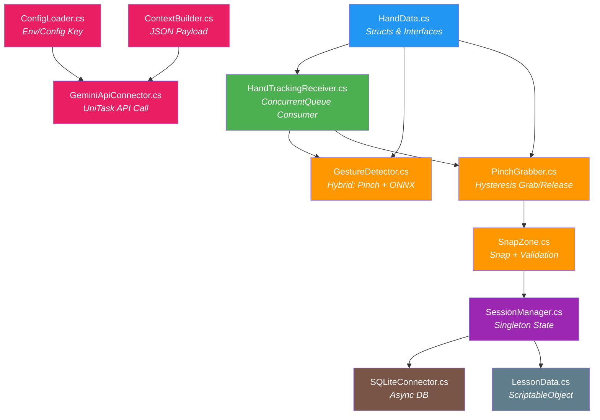

<div align="center">

# 🎯 Motion AR — Monitor AR Technical Training Simulator

**Giả lập đào tạo kỹ thuật tương tác 3D bằng cử chỉ tay qua Webcam**

[](https://unity.com/)
[](https://docs.microsoft.com/en-us/dotnet/csharp/)
[](https://python.org)
[](https://pytorch.org)
[](https://mediapipe.dev/)
[](https://ai.google.dev/)
[](LICENSE)

[🇻🇳 Tiếng Việt](#-giới-thiệu) • [📖 Documentation](3_AI_Agent_Workspace/TECHNICAL_REFERENCE.md) • [🗺️ Roadmap](implementation_plan.md)

</div>

---

## 📋 Mục lục

- [Giới thiệu](#-giới-thiệu)
- [Tính năng chính](#-tính-năng-chính)
- [Kiến trúc hệ thống](#-kiến-trúc-hệ-thống)
- [Cấu trúc thư mục](#-cấu-trúc-thư-mục)
- [Yêu cầu hệ thống](#-yêu-cầu-hệ-thống)
- [Cài đặt & Thiết lập](#-cài-đặt--thiết-lập)
- [Hướng dẫn sử dụng](#-hướng-dẫn-sử-dụng)
- [Auto-Commit Script](#-auto-commit-script)
- [Tech Stack](#-tech-stack)
- [Đóng góp](#-đóng-góp)
- [Giấy phép](#-giấy-phép)

---

## 🌟 Giới thiệu

**Motion AR** biến màn hình máy tính thành một **"tấm gương ma thuật"** — nơi người học có thể tương tác, bóc tách, và lắp ráp các mô hình kỹ thuật 3D (động cơ, bo mạch...) lơ lửng trước mặt bằng **cử chỉ tay thật** qua Webcam thông thường.

Dự án bao gồm **2 phân hệ chính**:

| Phân hệ | Mô tả |
|---|---|
| 🧠 **AI Model Training** (Python) | Pipeline Deep Learning huấn luyện mô hình nhận diện 14 cử chỉ tay động — từ thu thập dữ liệu (MediaPipe) → huấn luyện (MLP → CNN → LSTM → Transformer) → xuất ONNX |
| 🎮 **Unity AR Application** (C#) | Ứng dụng Unity 2022.3 LTS tương tác 3D — tracking tay qua Webcam, nhận diện cử chỉ bằng ONNX, lắp ráp linh kiện, trợ giảng AI (Gemini) |

### Triết lý thiết kế

| Nguyên tắc | Mô tả |
|---|---|
| 🖥️ **Hardware Agnostic** | Chỉ cần Webcam 720p — mọi tương tác không gian giải quyết qua thuật toán Computer Vision |
| ⚡ **Real-time & Thread-Safe** | Kiến trúc Producer-Consumer đảm bảo ≥30 FPS, triệt tiêu lỗi đa luồng Unity |
| 📦 **Modular & Offline-First** | Điều khiển vật lý xử lý cục bộ (0ms), chỉ gọi API đám mây khi cần trợ giảng AI |
| 🛡️ **Fail-Safe UX** | Bộ lọc Smoothing, Hysteresis chống nhiễu, tự giải phóng linh kiện khi mất tracking |

---

## ✨ Tính năng chính

### 🤚 Tương tác không gian bằng cử chỉ tay

- **Bóp/Chụm (Pinch)** — Gắp linh kiện 3D bằng ngón cái + ngón trỏ (0ms latency)
- **Xòe tay (Release)** — Thả linh kiện, tự bắt dính vào vị trí đúng
- **Vuốt (Swipe)** — Điều hướng menu và giáo án
- **Chạm (Tap) / Nắm đấm (Fist)** — Kích hoạt micro hỏi trợ lý AI
- **14 cử chỉ động** — Nhận diện bằng Transformer (ONNX) qua cửa sổ trượt 15 frames

### 🧩 Hệ thống lắp ráp thông minh

- **Snap System** — Linh kiện tự hút chặt khi đưa vào bán kính dung sai
- **Cảnh báo lỗi** — Đổi màu đỏ + âm thanh khi lắp sai vị trí
- **Giáo án Data-Driven** — Kịch bản lắp ráp cấu hình bằng ScriptableObject, không hard-code

### 🤖 Trợ giảng AI (Google Gemini)

- Hỏi đáp tự do bằng giọng nói
- AI hiểu ngữ cảnh 3D hiện tại (đang cầm linh kiện gì, bước nào, lỗi bao nhiêu)
- Phản hồi text + highlight vị trí đích trên mô hình

### 🧠 AI Model Training Pipeline

- **4 kiến trúc** đã huấn luyện: MLP (72.4%) → 1D-CNN (89.5%) → LSTM (94.3%) → **Transformer (95.8%)**
- **14 lớp cử chỉ**: Grab, Tap, Expand, Pinch, Rotation CW/CCW, Swipe (4 hướng), Swipe X/V/+, Shake
- **Xuất ONNX** cho Unity Sentis inference — input tensor `[1, 15, 63]`
- **Streamlit Web App** trình bày kết quả và so sánh mô hình

### 📊 Quản lý đào tạo

- Lưu lịch sử phiên học vào SQLite cục bộ
- Chấm điểm tự động dựa trên số lỗi (công thức: `score = max(0, 100 - mistakes × 10)`)
- Hệ thống đăng nhập người dùng

---

## 🏗️ Kiến trúc hệ thống

### Luồng dữ liệu Producer-Consumer

```
┌─────────────────────┐     ┌───────────────────────────────┐     ┌─────────────────────────────┐
│   BACKGROUND THREAD │     │   THREAD-SAFE QUEUE & BUFFER  │     │     MAIN THREAD (UNITY)     │
│  (MediaPipe Plugin) │     │                               │     │     (Update Loop)            │
├─────────────────────┤     ├───────────────────────────────┤     ├─────────────────────────────┤
│                     │     │                               │     │                             │
│ 1. Đọc Frame       │     │  ConcurrentQueue<HandData>    │     │ 1. Dequeue → Cursor 3D      │
│    từ Webcam        │ ══> │                               │ ══> │ 2. Pinch/Release (0ms)      │
│ 2. Suy luận        │     │  ─────────────────────────    │     │ 3. Sliding Window Buffer    │
│    21 Landmarks     │     │  Sliding Window Buffer        │     │ 4. ONNX Inference [1,15,63] │
│ 3. Gửi vào Queue   │     │  (15 frames gần nhất)         │     │ 5. Kích hoạt UI Events      │
│                     │     │                               │     │                             │
└─────────────────────┘     └───────────────────────────────┘     └─────────────────────────────┘
```

### Sơ đồ phụ thuộc giữa các Module



---

## 📂 Cấu trúc thư mục

```text
Motion_AR/                              # Root repository
│
├── 1_AI_Model_Training/                # 🧠 Pipeline huấn luyện AI (Python)
│   ├── Dataset/
│   │   └── raw_data.csv                # ~53MB — 2,800 mẫu × 15 frames × 63 features
│   ├── Models/
│   │   ├── best_mlp.pth                # Tuần 2-3: MLP Baseline (72.4%)
│   │   ├── best_transformer.pth        # Tuần 7: Transformer ★ Best (95.8%)
│   │   ├── gesture_model.onnx          # Model ONNX cho Unity Sentis
│   │   ├── gesture_model.onnx.data     # Weights data của ONNX model
│   │   └── scaler_params.json          # StandardScaler params (mean, scale)
│   ├── Notebooks/
│   │   ├── Tuan2_3_Baseline_MLP.ipynb  # MLP baseline — static frame
│   │   ├── Tuan4_CNN.ipynb             # 1D-CNN temporal convolution
│   │   ├── Tuan6_LSTM.ipynb            # LSTM + t-SNE visualization
│   │   ├── Tuan7_Transformer.ipynb     # Transformer + Attention maps
│   │   ├── Tuan8_Failure_Analysis.ipynb # Confusion Matrix & Error Analysis
│   │   └── Tuan9_ST_GCN_Concept.ipynb  # ST-GCN concept exploration
│   ├── Scripts/
│   │   ├── 1_collect_data.py           # Thu thập dữ liệu từ webcam
│   │   ├── 1b_extract_kinematics.py    # Trích xuất đặc trưng động học
│   │   ├── 2_generate_synthetic_data.py# Tạo dữ liệu tổng hợp
│   │   ├── 3_convert_dhg_dataset.py    # Chuyển đổi DHG-14/28
│   │   ├── 4_realtime_inference.py     # Nhận diện cử chỉ thời gian thực ★
│   │   ├── 5_os_controller.py          # Điều khiển OS bằng cử chỉ
│   │   ├── 6_universal_dataset_builder.py # Pipeline gộp nhiều dataset
│   │   ├── 7_export_onnx.py            # Xuất model sang ONNX
│   │   ├── 8_export_scaler.py          # Xuất StandardScaler params
│   │   ├── mediapipe_server.py         # UDP server cho Unity tracking
│   │   └── run_training.py             # Script huấn luyện Transformer
│   ├── app.py                          # Streamlit Web App trình bày kết quả
│   ├── requirements.txt                # Dependencies Python
│   └── README.md                       # Tài liệu riêng cho AI Training
│
├── 2_Unity_Project/                    # 🎮 Unity AR Application (C#)
│   └── Motion_AR/
│       ├── Assets/
│       │   ├── Scripts/
│       │   │   ├── AI/                 # Module Trợ giảng Gemini
│       │   │   │   ├── ConfigLoader.cs         # Đọc API Key (env → config.json)
│       │   │   │   ├── ContextBuilder.cs       # Sinh JSON payload ngữ cảnh 3D
│       │   │   │   ├── GeminiApiConnector.cs   # Gọi Gemini API (UniTask)
│       │   │   │   ├── AIChatPanel.cs          # UI panel chat với AI
│       │   │   │   ├── HighlightResponder.cs   # Highlight linh kiện theo AI response
│       │   │   │   └── VoiceInputManager.cs    # Thu giọng nói → text
│       │   │   ├── Core/               # Module Quản lý trạng thái
│       │   │   │   ├── SessionManager.cs       # Singleton quản lý phiên học
│       │   │   │   ├── SceneBootstrapper.cs    # Khởi tạo scene tự động
│       │   │   │   └── SettingsManager.cs      # Cài đặt ứng dụng
│       │   │   ├── Data/               # Module Dữ liệu giáo án
│       │   │   │   ├── LessonData.cs           # ScriptableObject bài học
│       │   │   │   └── StepData.cs             # Dữ liệu từng bước lắp ráp
│       │   │   ├── Database/           # Module Cơ sở dữ liệu
│       │   │   │   └── SQLiteConnector.cs      # CRUD SQLite cục bộ (async)
│       │   │   ├── Interaction/        # Module Tương tác không gian
│       │   │   │   ├── HandData.cs             # Struct/Enum/Interface nền tảng
│       │   │   │   ├── HandTrackingReceiver.cs # Consumer: ConcurrentQueue → Main Thread
│       │   │   │   ├── GestureDetector.cs      # Nhận diện cử chỉ lai (Pinch + ONNX)
│       │   │   │   ├── PinchGrabber.cs         # Gắp/thả với Hysteresis chống nhiễu
│       │   │   │   ├── SnapZone.cs             # Hệ thống bắt dính linh kiện
│       │   │   │   ├── GrabbablePart.cs        # Component linh kiện gắp được
│       │   │   │   ├── TrainingFlowController.cs # Điều phối luồng bài học
│       │   │   │   ├── MediaPipeUDPProvider.cs # Nhận dữ liệu tay qua UDP
│       │   │   │   └── WebcamBackground.cs     # Hiển thị webcam làm nền AR
│       │   │   └── UI/                 # Module Giao diện người dùng
│       │   │       ├── HUDManager.cs           # Quản lý HUD tổng thể
│       │   │       ├── CursorEffects.cs        # Hiệu ứng cursor (ring, pulse)
│       │   │       ├── HoverButton.cs          # Nút bấm bằng hover tay
│       │   │       ├── SlidePanel.cs           # Panel trượt trái/phải
│       │   │       ├── InstructionDisplay.cs   # Hiển thị hướng dẫn bước
│       │   │       ├── ProgressTracker.cs      # Thanh tiến độ bài học
│       │   │       ├── ScoreDisplay.cs         # Bảng điểm kết quả
│       │   │       ├── ErrorOverlay.cs         # Flash đỏ khi lắp sai
│       │   │       ├── ObjectHighlight.cs      # Highlight linh kiện 3D
│       │   │       └── AudioFeedbackManager.cs # Quản lý âm thanh phản hồi
│       │   ├── Models_ONNX/            # File ONNX model cho Sentis
│       │   ├── StreamingAssets/        # Config files (runtime)
│       │   ├── Plugins/               # UniTask, NuGet packages
│       │   └── Scenes/                # Unity Scenes
│       ├── Packages/                  # Unity Package Manager
│       ├── ProjectSettings/           # Unity Project Settings
│       └── Library/                   # Unity Cache (ignored)
│
├── 3_AI_Agent_Workspace/               # 📚 Tài liệu kỹ thuật & thiết kế
│   ├── README.md                       # Tổng quan dự án (chi tiết)
│   ├── TECHNICAL_REFERENCE.md          # API Reference — classes, methods, events
│   ├── Motion AR.md                    # Master Plan V3.1
│   ├── ROADMAP.md                      # Lộ trình phát triển
│   └── DEV_LOG.md                      # Nhật ký phát triển
│
├── .gitignore                          # Loại trừ file tạm/build/data lớn
├── auto_commit.py                      # 🔄 Script tự động commit (xem bên dưới)
├── implementation_plan.md              # Roadmap chi tiết theo Phase
└── README.md                           # 📖 Tài liệu tổng quan (file này)
```

---

## 💻 Yêu cầu hệ thống

### Phần cứng tối thiểu

| Thành phần | Yêu cầu |
|---|---|
| CPU | Intel Core i3 / AMD Ryzen 3 trở lên |
| GPU | GPU tích hợp (Intel UHD / AMD Vega) |
| RAM | 4 GB |
| Webcam | 720p @ 30fps |
| OS | Windows 10/11 (x86_64) |

### Phần mềm yêu cầu

| Công cụ | Phiên bản | Mục đích |
|---|---|---|
| **Unity Editor** | 2022.3.x LTS | Engine chính |
| **Python** | 3.10+ | AI Training pipeline |
| **Git** | 2.x | Version control |
| **pip** | Latest | Quản lý thư viện Python |

---

## 🚀 Cài đặt & Thiết lập

### 1. Clone repository

```bash
git clone https://github.com/HIepNgoc2006/Motion_AR.git
cd Motion_AR
```

### 2. Thiết lập AI Training (Python)

```powershell
# Di chuyển vào thư mục AI Training
cd 1_AI_Model_Training

# Tạo và kích hoạt môi trường ảo
python -m venv venv
.\venv\Scripts\activate

# Cài đặt dependencies
pip install -r requirements.txt

# (Tùy chọn) Cài thêm Streamlit để chạy Web App trình bày
pip install streamlit plotly
```

### 3. Thiết lập Unity Project

1. Mở **Unity Hub** → **Add** → chọn thư mục `2_Unity_Project/Motion_AR/`
2. Đảm bảo dùng **Unity 2022.3.x LTS** (KHÔNG dùng Unity 6)
3. Mở project → chờ import xong → kiểm tra Console **0 lỗi đỏ**
4. Cài đặt packages qua **Package Manager**:

| Package | Cách cài |
|---|---|
| URP | `com.unity.render-pipelines.universal` |
| Unity Sentis | `com.unity.sentis` (version 2.1.3) |
| UniTask | Git URL: `https://github.com/Cysharp/UniTask.git?path=src/UniTask/Assets/Plugins/UniTask` |
| Newtonsoft.Json | `com.unity.nuget.newtonsoft-json` |
| sqlite-net-pcl | Import qua NuGet (xem `packages.config`) |

### 4. Cấu hình API Key (Gemini — tùy chọn)

**Cách 1 — Biến môi trường (khuyến nghị):**
```powershell
[System.Environment]::SetEnvironmentVariable("GEMINI_API_KEY", "your-api-key-here", "User")
```

**Cách 2 — File cấu hình:**
Tạo file `Assets/StreamingAssets/config.json`:
```json
{
  "geminiApiKey": "your-api-key-here",
  "geminiModel": "gemini-2.0-flash",
  "geminiTimeoutSeconds": 5
}
```

### 5. Chạy MediaPipe Server (cho hand tracking thực tế)

```powershell
# Terminal 1 — Chạy Python MediaPipe Server
cd 1_AI_Model_Training
.\venv\Scripts\activate
python Scripts/mediapipe_server.py

# Terminal 2 — Chạy Unity Project (Play mode trong Editor)
```

### 6. Chạy Real-time Inference (standalone, không cần Unity)

```powershell
cd 1_AI_Model_Training
.\venv\Scripts\activate
python Scripts/4_realtime_inference.py
```

| Phím | Chức năng |
|---|---|
| **Q / ESC** | Thoát |
| **M** | Chuyển đổi Transformer ↔ LSTM |

### 7. Chạy Streamlit Web App

```powershell
cd 1_AI_Model_Training
.\venv\Scripts\activate
streamlit run app.py
# Mở trình duyệt tại http://localhost:8501
```

---

## 🔄 Auto-Commit Script

Dự án đi kèm script `auto_commit.py` — tự động commit khi phát hiện thay đổi file.

### Cơ chế hoạt động

1. **Watchdog** theo dõi toàn bộ thư mục dự án (recursive)
2. Tự động bỏ qua các file trong `.gitignore` (dataset lớn, build, cache...)
3. Khi phát hiện thay đổi (tạo/sửa/xóa), **debounce 5 giây** — gom nhiều thay đổi liên tiếp thành 1 commit
4. Tự tạo commit message mô tả: `auto: sửa README.md, GestureDetector.cs [2026-06-09 10:30:45]`
5. Tùy chọn auto-push lên remote

### Cài đặt & Chạy

```powershell
# Cài đặt dependency
pip install watchdog

# Chạy script (chỉ commit local, không push)
python auto_commit.py

# Chạy với auto-push
python auto_commit.py --push

# Tùy chỉnh debounce (10 giây)
python auto_commit.py --debounce 10

# Chạy nền (Windows)
Start-Process -NoNewWindow python -ArgumentList "auto_commit.py"

# Hoặc dùng biến môi trường
$env:AUTO_PUSH = "true"
$env:DEBOUNCE_SECONDS = "10"
python auto_commit.py
```

### Dừng script

- **Foreground**: Nhấn `Ctrl+C`
- **Background**: Dùng Task Manager hoặc `Stop-Process -Name python`

### Tham số dòng lệnh

| Tham số | Mặc định | Mô tả |
|---|---|---|
| `--path` | Thư mục hiện tại | Đường dẫn repo cần theo dõi |
| `--debounce` | `5` (giây) | Thời gian chờ trước khi commit |
| `--push` | `false` | Tự động push sau mỗi commit |
| `--log-file` | `auto_commit.log` | Đường dẫn file log |

### Biến môi trường

| Biến | Giá trị | Mô tả |
|---|---|---|
| `AUTO_PUSH` | `true` / `false` | Bật/tắt auto-push |
| `DEBOUNCE_SECONDS` | Số giây | Override debounce time |

> ⚠️ **Lưu ý**: Script dựa hoàn toàn vào `.gitignore` để lọc file. Đảm bảo `.gitignore` đã được cấu hình đúng trước khi chạy. File log `auto_commit.log` đã được thêm vào `.gitignore`.

---

## 🔧 Tech Stack

### Unity Application

| Phân hệ | Công nghệ | Vai trò |
|---|---|---|
| **Logic & Đồ họa** | Unity 2022.3 LTS (URP, C#) | Engine chính xử lý render và vật lý |
| **Thị giác máy tính** | MediaPipe Hands (Python → UDP) | Tracking 21 landmarks ngón tay (luồng ngầm) |
| **Đồng bộ đa luồng** | `ConcurrentQueue<T>` | Producer-Consumer giữa CV Thread ↔ Main Thread |
| **Nhận diện cử chỉ** | Unity Sentis (.ONNX) | Suy luận Transformer trên tensor [1, 15, 63] |
| **Xử lý bất đồng bộ** | UniTask | Async/Await tối ưu, thay thế Coroutine |
| **Trợ giảng AI** | Gemini 2.0 Flash API | Nhận context JSON, phản hồi tư vấn lắp ráp |
| **Cơ sở dữ liệu** | SQLite (sqlite-net-pcl) | Lưu lịch sử cục bộ, không cần server |
| **Serialization** | Newtonsoft.Json | Parse JSON cho LLM payload và config |

### AI Training Pipeline

| Phân hệ | Công nghệ | Vai trò |
|---|---|---|
| **Framework** | PyTorch 2.0+ | Huấn luyện MLP, CNN, LSTM, Transformer |
| **Computer Vision** | MediaPipe + OpenCV | Thu thập dữ liệu 21 landmarks 3D |
| **Data Science** | Pandas, Scikit-learn | Xử lý dữ liệu, StandardScaler |
| **Visualization** | Matplotlib, Seaborn | Biểu đồ loss, confusion matrix, t-SNE |
| **Web App** | Streamlit | Dashboard trình bày kết quả |
| **Model Export** | ONNX | Chuyển đổi model cho Unity Sentis |

### Kết quả huấn luyện

| Mô hình | Tuần | Accuracy | F1-Score | Parameters |
|---|---|---|---|---|
| 🧮 MLP (Baseline) | 2-3 | 72.4% | 0.71 | 57,678 |
| 📊 1D-CNN | 4 | 89.5% | 0.89 | 198,542 |
| 🔄 LSTM | 5-6 | 94.3% | 0.94 | 231,822 |
| ⚡ **Transformer** ★ | 7 | **95.8%** | **0.96** | 248,206 |

---

## 🎮 Hướng dẫn sử dụng

### Hành trình người học

```
1. Khởi động & Hiệu chuẩn
   ├── Đăng nhập
   ├── Xòe tay vừa khung Bounding Box
   └── Kéo/đẩy mặt phẳng Z để chỉnh độ sâu

2. Chọn Bài học
   ├── Vuốt tay (Swipe) để mở Menu
   └── Rê ngón tay vào nút bài học (Hover 0.3s)

3. Thực hành lắp ráp
   ├── Bóp (Pinch) để gắp linh kiện
   ├── Di chuyển linh kiện đến mô hình 3D
   └── Thả → Snap tự động + tiếng Click

4. Hỏi Trợ lý AI
   ├── Cử chỉ Tap → Micro mở
   ├── Hỏi: "Linh kiện này lắp vào đâu?"
   └── AI trả lời + highlight vị trí đích

5. Hoàn thành
   ├── Lưu kết quả vào SQLite
   └── Hiển thị bảng điểm
```

### Bảng cử chỉ

| Cử chỉ | Hành động | Phương thức nhận diện |
|---|---|---|
| 🤏 Bóp ngón tay (Pinch) | Gắp linh kiện | Euclidean + Hysteresis (0ms) |
| 🖐️ Xòe tay (Release) | Thả linh kiện | Euclidean + Hysteresis (0ms) |
| 👈 Vuốt trái/phải (Swipe) | Lật trang menu | ONNX Deep Learning |
| 👆 Chạm (Tap) | Kích hoạt micro | ONNX Deep Learning |
| ✊ Nắm đấm (Fist) | Kích hoạt micro | ONNX Deep Learning |

---

## 🤝 Đóng góp

Chúng tôi hoan nghênh mọi đóng góp! Để đóng góp:

1. **Fork** repository
2. Tạo branch mới: `git checkout -b feature/ten-tinh-nang`
3. Commit thay đổi: `git commit -m "feat: thêm tính năng mới"`
4. Push lên branch: `git push origin feature/ten-tinh-nang`
5. Tạo **Pull Request**

### Quy ước commit message

```
feat:     Tính năng mới
fix:      Sửa lỗi
docs:     Thay đổi tài liệu
refactor: Tái cấu trúc code
test:     Thêm/sửa test
auto:     Commit tự động bởi auto_commit.py
```

### Cấu trúc code Unity

- Tuân thủ **5 namespace**: `MotionAR.Interaction`, `MotionAR.Core`, `MotionAR.Data`, `MotionAR.AI`, `MotionAR.Database`
- Mọi hàm public phải có `/// <summary>` XML doc
- Dùng `[SerializeField]` thay vì `public` fields
- Dùng `UniTask` thay vì `Coroutine`
- KHÔNG dùng `GameObject.Find()` — tham chiếu qua Inspector

---

## 📚 Tài liệu liên quan

| Tài liệu | Mô tả |
|---|---|
| [TECHNICAL_REFERENCE.md](3_AI_Agent_Workspace/TECHNICAL_REFERENCE.md) | API Reference — classes, methods, events |
| [setup_and_deployment_guide.md](3_AI_Agent_Workspace/Documentation/setup_and_deployment_guide.md) | Hướng dẫn Setup & Triển khai dự án trên Unity (Mới) |
| [Motion AR.md](3_AI_Agent_Workspace/Motion%20AR.md) | Master Plan V3.1 — đặc tả đầy đủ |
| [implementation_plan.md](implementation_plan.md) | Roadmap chi tiết 6 phases |
| [1_AI_Model_Training/README.md](1_AI_Model_Training/README.md) | Tài liệu riêng cho pipeline AI |
| [DEV_LOG.md](3_AI_Agent_Workspace/DEV_LOG.md) | Nhật ký phát triển |

---

## 📄 Giấy phép

Dự án được phân phối dưới giấy phép **MIT License**. Xem file [LICENSE](LICENSE) để biết thêm chi tiết.

---

<div align="center">

**Motion AR** — Bình dân hóa công nghệ đào tạo AR

Built with ❤️ using Unity, PyTorch, MediaPipe, and Gemini AI

⭐ Star repo nếu bạn thấy hữu ích! ⭐

</div>
